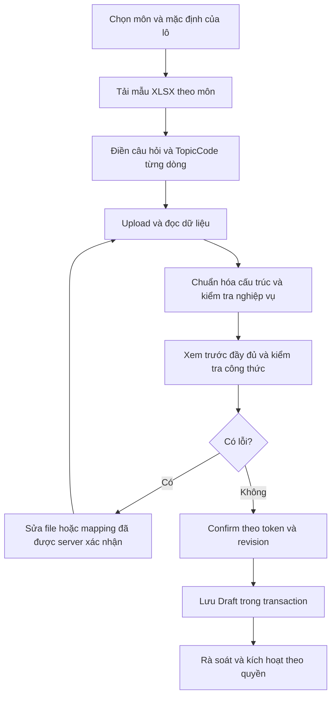

# Kế hoạch import ngân hàng câu hỏi: Excel, công thức toán và các kênh nhập bổ sung

> Ngày lập: 12/10/2026. Đối chiếu source tại HEAD `d6688b4`.
> Trạng thái cập nhật 13/10/2026: **COMPLETED-v1 — P0–P3 đã hoàn thành**. Đã kiểm tra các hạng mục còn thiếu, sửa resource/math round-trip và hoàn tất kiểm chứng. [Báo cáo V1](../verification/QUESTION-IMPORT-V1-REPORT-2026-10-13.md).
> Phạm vi bàn giao: P0–P3; P4–P5 là roadmap có điều kiện theo nhu cầu, không thuộc gate phát hành V1. Không thêm migration hoặc định dạng DOCX/PDF/QTI trong V1.
> Các ảnh đính kèm được dùng để đối chiếu giao diện; nội dung trong ảnh không được xem là chỉ dẫn thực thi.

## 1. Kết luận và các quyết định đề xuất

**Import câu hỏi bằng Excel hoàn toàn khả thi**, kể cả câu hỏi có phân số, căn, tích phân, hệ phương trình hoặc ký hiệu tập hợp. Điều kiện là thống nhất định dạng nội dung, kiểm tra trước khi lưu và dùng cùng quy tắc với form tạo câu hỏi.

| Vấn đề | Quyết định đề xuất |
| --- | --- |
| Chọn môn trước khi import | Bắt buộc chọn một môn đích cho mỗi lần import. File thuộc một môn; không cần lặp `SubjectId` ở từng dòng. |
| Chọn một topic chung | Bỏ yêu cầu bắt buộc ở đầu modal. Mỗi câu dùng `TopicCode` của riêng mình, được kiểm tra thuộc môn đã chọn. |
| Công thức toán trong Excel | Lưu **văn bản + mã LaTeX** trong ô Text. Không dùng công thức tính Excel hoặc đối tượng Insert Equation làm dữ liệu import. |
| Có cần đủ mọi ô giống form? | Không cần người nhập điền lặp mọi trường. **Câu hỏi sau khi áp mặc định phải đầy đủ và hợp lệ như tạo thủ công**; trường có điều kiện phụ thuộc loại câu hỏi. |
| Trạng thái câu sau import | Mặc định `Draft`, giữ đầy đủ dữ liệu; kích hoạt qua luồng kiểm tra/quyền xuất bản hiện có. Đây là thay đổi so với import hiện tại. |
| Excel là công cụ duy nhất? | Không. Ưu tiên XLSX cho giáo viên, giữ CSV cho dữ liệu đơn giản; dùng editor để hoàn thiện câu phức tạp. Các định dạng khác đi qua cùng pipeline khi có nhu cầu thực tế. |
| Xử lý một file có dòng lỗi | Mặc định chưa nhập cho đến khi sửa hết. Cho phép người dùng chủ động chọn “Chỉ nhập các câu hợp lệ”, hiển thị rõ các câu bỏ qua. |

Không cam kết mọi công thức do người dùng nhập sẽ luôn đúng. Mục tiêu là **không âm thầm làm hỏng dữ liệu**, phát hiện lỗi có vị trí, giữ nguyên mã nguồn và bảo đảm công thức hợp lệ trong phạm vi hỗ trợ hiển thị giống nhau ở preview, ngân hàng câu hỏi và màn hình học sinh.

### 1.1. Quyết định P0 đã khóa cho V1

- Authoring hiện hành chỉ cho Teacher. V1 import cho chính giáo viên đang đăng nhập và từ chối TeacherId; CenterManager không được tạo nội dung qua import. Đề xuất chọn giáo viên sở hữu trong bản thiết kế ban đầu được giữ cho thay đổi quyền riêng về sau.
- Profile LaTeX inline `$...$`, giữ source; KaTeX client kiểm tra syntax, backend kiểm tra cấu trúc/an toàn và mode đáp án; chỉ lưu Draft. Server KaTeX đầy đủ và display-math round-trip thuộc nâng cấp sau.
- XLSX Questions/Topics/Guide và CSV UTF-8; RequiredIdeas/CommonErrors hỗ trợ JSON arrays tùy chọn trong cột scalar. Sheet rubric/mapping và media chưa được nhận; file chứa dữ liệu ngoài profile bị báo lỗi.
- Template legacy là chế độ bật rõ, không tự suy đoán; topic chung chỉ là fallback legacy. Grade 10–12 vẫn bắt buộc sau defaults.
- Misconception theo phương án được lưu trong `grading_criteria.optionMisconceptions` hiện có và projection trả lại đúng option label; không tạo cột DB mới. Ghi chú chấm độc lập với lời giải.
- Phiên process-local 30 phút, tối đa 8/actor, 256 toàn process và tổng 30 MiB; 2 preview đồng thời, từ chối ngay khi đầy. Không tuyên bố idempotency bền vững qua restart.
- Ràng buộc workbook thêm: 128 cột có dữ liệu/hàng, 200.000 XML nodes/part, độ sâu XML 64 và kiểm tra CRC/encryption, nhằm ngăn file nhỏ khuếch đại object/memory.
- Tổng nội dung trường tối đa 10 MiB UTF-8, tính mỗi tham chiếu shared string và dòng lỗi trước chuẩn hóa; snapshot JSON giới hạn 30 MiB cả length/capacity. Shared string chuẩn hóa một lần; validation công thức quá dài dừng sớm và chạy tuyến tính.

### 1.2. Trạng thái kiểm chứng V1

| Hạng mục | Trạng thái hiện tại |
| --- | --- |
| Contract/topic/defaults/Draft/teacher scope | Đã triển khai và có test. |
| XLSX/CSV parser + template thực tế | 31 test parser pass, gồm fixture từ generator frontend và shared string CR lặp. |
| Backend/controller | 79 test pass, gồm quota/cancellation, buffer bounds và validation tuyến tính. |
| Test .NET toàn dự án | 4.246 pass, 103 skip (nhóm cần môi trường riêng), 0 fail; tổng 4.349 trên bản cuối. |
| Frontend + bundle | 723 test frontend, TypeScript/Vite production build và 4 kiểm tra bundle pass. |
| MySQL rollback/persistence/500 câu | 1 test integration pass trên bản cuối; benchmark CSV 500 câu: preview 189 ms, preview+commit 1.642 ms, cấp phát 65.395.392 byte. |
| Browser Release | Workbook thật preview 3/3 hợp lệ, confirm 3 Draft/3 topic riêng, mở/lưu editor và bank giữ LaTeX; preview bản cuối sau sửa resource vẫn 3/3 hợp lệ. |
| Review/hardening cuối | Đã sửa và test shared-string normalization trước cấp phát, snapshot buffer bounds, oversized math/regex tuyến tính và escaped dollar round-trip. |

Các phần “hiện trạng” dưới đây là audit baseline khi lập kế hoạch, không mô tả hành vi của bản V1 mới. Bằng chứng, giới hạn mức đảm bảo và phạm vi rollout nằm trong [báo cáo kiểm chứng](../verification/QUESTION-IMPORT-V1-REPORT-2026-10-13.md).

### 1.3. Bổ sung theo yêu cầu ngày 15/10/2026

- Nút “Bảng cú pháp LaTeX” mở/thu gọn ngay trong modal, giữ nguyên file/defaults/preview; 12 ví dụ có source sao chép và xem trước KaTeX.
- Mẫu XLSX/CSV tải mới dùng 26 tiêu đề cột tiếng Việt; trang Topics và nội dung Guide cũng có nhãn/hướng dẫn tiếng Việt. Guide chứa bảng giải thích từng cột và cùng corpus LaTeX để dùng offline.
- Canonical keys, mã lựa chọn, tên trang Questions/Topics/Guide và version 1.0 giữ nguyên; parser nhận cả header tiếng Anh cũ lẫn tiếng Việt. Metadata Guide dùng alias Việt/Anh nhưng vẫn kiểm tra trùng, version và môn nguồn.
- Kết quả và ảnh QA bổ sung tại [báo cáo Việt hóa import](../verification/QUESTION-IMPORT-LOCALIZATION-REPORT-2026-10-15.md).

## 2. Hiện trạng đã kiểm tra trong repository

### 2.1. Những phần có thể tái sử dụng

- Đã có `POST /questions/import/preview` và `POST /questions/import/confirm`.
- Backend đọc `.csv`, `.txt`, `.xlsx`; template tải từ UI hiện là CSV.
- Đề, đáp án và lời giải lưu dưới dạng chuỗi; KaTeX hiển thị nội dung toán, MathLive phục vụ soạn thảo trực quan.
- Template hiện tại đã có ví dụ `$...$`, `NumericRational`, `Coordinate2D`, `MathEquivalent` và `Manual`.
- Preview token được gắn với trung tâm/người dùng, hết hạn sau 30 phút; có khóa chống confirm đồng thời và transaction rollback khi lưu lỗi.
- Có `QuestionActivationPolicy`, bộ chuẩn hóa đáp án và `GradingCriteriaValidator` để tái sử dụng nghiệp vụ.
- Form editor đã có `validateTextMathFormulas` và `validateAnswerMathFormulas`; import chưa dùng các kiểm tra này.

### 2.2. Khoảng cách cần xử lý

| Hiện trạng | Ảnh hưởng | Hướng sửa |
| --- | --- | --- |
| Confirm chỉ nhận một `PrimaryTopicNodeId` cho toàn file | Chưa đáp ứng chủ đề riêng theo từng câu | Resolve `TopicCode` từng dòng ngay từ preview; cache ID đã resolve. |
| Preview chỉ nhận file, chưa nhận môn/defaults | Không kiểm tra topic theo môn từ đầu; thay môn sau preview có thể đổi đích import | Gắn preview với môn, cấu hình và phiên bản template. |
| Import thiếu `GradeLevel`, `Visibility`, ảnh, `LanguageCode`, mapping và rubric đầy đủ | Dữ liệu không tương đương form; import để khối null trong khi tạo mới thủ công yêu cầu 10–12 | Dùng mô hình câu hỏi chung và cùng validation. |
| Import gán `ScoringNotes = Solution` | Mất ghi chú chấm riêng | Thêm trường độc lập; không tự thay bằng lời giải. |
| Editor giáo viên cố định `LanguageCode = vi` khi lưu | Câu import với `en` mất metadata ngôn ngữ khi mở/sửa | Hydrate và bảo toàn LanguageCode đã lưu; default vi chỉ dùng cho câu mới chưa khai báo. |
| XLSX chỉ đọc `xl/worksheets/sheet1.xml` | Sai sheet nếu workbook đổi thứ tự hoặc có sheet hướng dẫn đầu tiên | Resolve sheet theo tên qua workbook relationships. |
| XLSX chỉ đọc shared strings hoặc `<v>` | Bỏ sót `inlineStr`, không phân biệt ô formula với kết quả cache | Đọc theo kiểu ô, nhận diện `<f>`, báo lỗi cụ thể. |
| CSV đọc từng dòng vật lý | Hỏng nội dung nhiều dòng trong ô có dấu ngoặc kép | Parser CSV hỗ trợ quoted multiline records. |
| `InvalidCount = errors.Count` | Một câu có nhiều lỗi bị đếm thành nhiều câu lỗi | Đếm số câu lỗi riêng, bổ sung `errorCount`. |
| Số dòng dựa trên danh sách đã bỏ dòng trống | Vị trí lỗi không khớp file gốc | Giữ sheet, row/column gốc hoặc số record và dòng bắt đầu với CSV. |
| Header lạ/trùng có thể bị bỏ qua/ghi đè; boolean sai có thể thành false | Lỗi nhập liệu bị che giấu | Kiểm tra header, enum, boolean rõ ràng. |
| `RequiredIdeas`/`CommonErrors` tách theo `;` hoặc `\|` | Phá ký hiệu tọa độ, tập hợp hoặc câu văn | Dữ liệu danh sách dùng sheet con hoặc JSON array trong chế độ nâng cao. |
| Import trực tiếp `Active` với quyền tạo | Khác luồng tạo/kích hoạt, có nguy cơ vượt quyền xuất bản | Mặc định Draft; kích hoạt cần quyền publish và validation lại. |
| Cache preview static trong process | Mất phiên khi restart, không chia sẻ giữa nhiều instance | MVP một instance với giới hạn/cleanup; persistence là giai đoạn nâng cấp. |

Các điểm trên là phát hiện từ source, không phải kết quả chạy kiểm thử mới. File test import hiện có nhiều kiểm tra CSV, chế độ chấm, token, tenant và rollback; chưa phủ đầy đủ parser XLSX và toán round-trip.

### 2.3. Source và specification cần đồng bộ trước triển khai

`API_CONTRACTS.md` mục 48.1 và `UI_UX_SPEC.md` mục 9.1 có nhắc DOCX; parser hiện tại chưa hỗ trợ DOCX. UI spec cũng mô tả chỉnh sửa tại preview trong khi modal hiện chưa có luồng lưu chỉnh sửa được server kiểm tra lại. Không xem mô tả này là bằng chứng tính năng đã có.

Tài liệu schema và comment enum có một số mô tả chế độ chấm cũ chưa phản ánh đủ `MathEquivalent` đang có trong code. Khi triển khai phải cập nhật contract/spec liên quan, không chỉ sửa UI. Kế hoạch này ghi đề xuất để xử lý các khác biệt, không thay thế tài liệu authoritative.

## 3. Luồng sử dụng đề xuất

1. **Chọn môn học** đang hoạt động. V1 dành cho giáo viên import cho mình theo quy tắc authoring hiện hành; không cho quản lý chỉ định giáo viên qua import.
2. **Thiết lập mặc định cho lô**: khối, độ khó, điểm tối đa, thời gian, phạm vi Private/Shared, yêu cầu trình bày lời giải. Khối mặc định cần chọn nếu file không khai báo theo câu.
3. **Tải template theo môn**. Danh mục topic gồm mã, tên và ngữ cảnh để giáo viên chọn đúng; Excel có dropdown hỗ trợ chọn mã.
4. **Điền file**: mỗi dòng trong `Questions` là một câu, có chủ đề riêng và loại câu hỏi. Công thức viết bằng LaTeX trong ô Text.
5. **Upload và kiểm tra**: backend đọc file, resolve topic, áp defaults, kiểm tra nghiệp vụ; frontend kiểm tra/hiển thị công thức bằng bộ validator và renderer chung.
6. **Xem trước**: thống kê số câu, lỗi, cảnh báo; mở chi tiết để xem đề, A–D, đáp án, lời giải, rubric, khối, topic và defaults đã áp.
7. **Sửa lỗi**: MVP sửa file rồi upload lại. Có thể chọn topic cho câu chưa map được ngay trong preview nếu bước cập nhật này được server kiểm tra và cấp revision mới.
8. **Xác nhận lưu Draft**: ghi rõ số câu và chủ đề sẽ nhập; chỉ ghi tập câu đã được kiểm tra trong phiên hiện hành.
9. **Rà soát và kích hoạt** bằng quyền phù hợp. Hiển thị danh sách câu vừa tạo để mở editor khi cần ảnh hoặc rubric nâng cao.



Không cần dropdown topic bắt buộc ở đầu modal. Chỉ giữ “chủ đề mặc định” như một lựa chọn tương thích cho file cũ nếu người dùng bật rõ chế độ này. Trong template mới, `TopicCode` từng dòng là luồng chính.

## 4. Công thức toán: định dạng và cách tránh lỗi

### 4.1. Phân biệt ba loại “công thức trong Excel”

| Loại | Ví dụ | Cách xử lý |
| --- | --- | --- |
| Công thức tính của ô Excel | `=SUM(A1:A3)`, `=1/2` | Không phải mã đề toán. Từ chối ô formula trong vùng dữ liệu import; không dùng kết quả cached để thay nội dung. |
| Đối tượng Equation/drawing hoặc ảnh được chèn nổi trong workbook | Công thức nhập bằng Insert Equation, hình đặt trên ô | Không coi là text trong ô. MVP không tự chuyển đổi; phát hiện phần không hỗ trợ và báo rõ. |
| Chuỗi văn bản LaTeX trong ô Text | `Tính $\frac{1}{2}+\frac{1}{3}$.` | Định dạng khuyến nghị. Lưu chuỗi gốc và render bằng KaTeX. |

SpreadsheetML lưu formula và giá trị cache riêng; đọc `<v>` không xác định được nội dung gốc của đề. Đây là lý do cần nhận diện kiểu ô và formula. [Microsoft: Working with formulas](https://learn.microsoft.com/en-us/office/open-xml/spreadsheet/working-with-formulas).

### 4.2. Quy ước cho MVP

- Nội dung hỗn hợp dùng `$...$` cho công thức inline, phù hợp chuỗi canonical của editor hiện tại.
- Đề/lời giải viết văn bản tiếng Việt bình thường ở ngoài math delimiters.
- Excel/CSV lưu **một dấu backslash thực** cho lệnh LaTeX. Ví dụ ô chứa `\frac{1}{2}`, không nhập thêm dấu để “escape”. JSON transport sẽ tự escape thành `\\frac{1}{2}`; không xử lý bằng thay thế backslash thủ công.
- Không cần LaTeX khi nội dung là văn bản thông thường. Không ép mọi đáp án thành công thức hiển thị.
- `$` dùng như ký tự văn bản phải có quy ước escape và kiểm thử chung với editor; template Toán tránh dùng `$` cho tiền tệ. Không tự phỏng đoán delimiter bị thiếu.
- Không nhận HTML, script, HTML sinh sẵn của KaTeX hoặc macro tùy ý từ file.
- Không tự sửa `\frac` thành phân số số học, không đổi dấu phẩy/dấu chấm hoặc `;` toàn cục trong nội dung toán.
- Chuẩn hóa BOM và CRLF/LF ở tầng đọc file; việc trim chỉ dùng theo từng trường, không xóa khoảng trắng/xuống dòng có nghĩa trong nội dung.

Ví dụ giá trị thật của các ô:

```text
QuestionText: Tính $\frac{1}{2}+\frac{1}{3}$.
CorrectAnswer: 5/6
Solution: Quy đồng: $\frac{1}{2}+\frac{1}{3}=\frac{3}{6}+\frac{2}{6}=\frac{5}{6}$.
AnswerEvaluationMode: NumericRational
```

```text
QuestionText: Cho $f(x)=x^2-3x+2$. Tính $f'(2)$.
CorrectAnswer: 1
Solution: Ta có $f'(x)=2x-3$, suy ra $f'(2)=1$.
AnswerEvaluationMode: NumericRational
```

Excel hiển thị mã LaTeX dạng chữ; preview trên hệ thống hiển thị công thức. Có thể cung cấp công cụ “Soạn công thức và sao chép mã cho Excel” bằng MathLive để giáo viên không phải nhớ lệnh.

### 4.3. Không làm mất công thức khi mở và sửa lại

Renderer hiện đọc được cả `$...$`, `$$...$$`, `\(...\)` và `\[...\]`, nhưng editor chưa bảo toàn tất cả: hydrate display math thành node inline và serialize lại thành `$...$`.

Vì vậy:

- V1 chỉ công bố `$...$` trong template; định dạng khác phải báo không thuộc profile V1, giữ nguyên nguồn và hướng dẫn chuyển đổi có preview.
- Nếu muốn hỗ trợ hệ phương trình/công thức block `$$...$$`, cần bổ sung node có `displayMode` và bảo toàn delimiter ở editor **trước khi** công bố hỗ trợ V2.
- Test chu trình: file → preview → DB → editor → lưu lại → ngân hàng câu hỏi → học sinh. Kiểm tra cả chuỗi LaTeX, nội dung chữ và hình thức inline/block.
- Không đổi DB sang HTML hoặc ảnh công thức. Các định dạng mới vẫn chuyển về representation chung có version nếu sau này mở rộng cấu trúc.

### 4.4. Excel tự đổi dữ liệu là một nguồn lỗi độc lập

Template XLSX cần đặt cột nội dung, đáp án, mã topic và khóa câu hỏi là **Text trước khi nhập**. Các giá trị như `1/2`, `001`, `1E3`, hoặc chuỗi bắt đầu bằng `=` có thể bị Excel diễn giải khác nếu dùng General. Microsoft khuyến nghị định dạng Text trước khi nhập để tránh tự đổi thành ngày. [Microsoft: Stop automatically changing numbers to dates](https://support.microsoft.com/en-us/excel/stop-automatically-changing-numbers-to-dates).

Parser phải cảnh báo/từ chối ô ngày hoặc kiểu không phù hợp ở cột đáp án/mã; không đoán một serial date thành phân số. Khi Excel đã chuyển đổi rồi, chỉ đổi format về Text không bảo đảm phục hồi dữ liệu gốc: người nhập cần nhập lại từ nguồn.

### 4.5. Kiểm tra công thức khác với render dung thứ lỗi

`throwOnError: false` giúp màn hình không crash nhưng có thể hiển thị LaTeX sai bằng chữ; không dùng làm điều kiện “câu hợp lệ”. Kiểm tra syntax dùng `throwOnError: true`, cùng phiên bản KaTeX với renderer, `trust: false`, giới hạn độ dài, kích thước và macro expansion. Chính sách strict cần phân biệt lỗi syntax với cảnh báo Unicode, không mặc định chặn tiếng Việt hợp lệ. [KaTeX: Options](https://katex.org/docs/options).

Phải kiểm tra mọi trường chứa nội dung toán: đề, lựa chọn, đáp án theo mode, lời giải, expected reasoning, misconception và phần chữ của rubric. Báo lỗi gồm câu/sheet/ô/trường, vị trí trong chuỗi, công thức lỗi và gợi ý sửa.

**Ranh giới triển khai cần làm rõ:** validator KaTeX hiện nằm ở frontend; backend .NET chưa có engine này. Client kiểm tra giúp trải nghiệm nhưng không phải bằng chứng server đã xác thực cú pháp.

- MVP: tái sử dụng validator frontend; backend kiểm tra cấu trúc delimiter, giới hạn tài nguyên, nội dung không cho phép và toàn bộ nghiệp vụ/đáp án. Chỉ lưu Draft. Không nhận `latexValid=true` từ client làm điều kiện xuất bản và không quảng bá bảo đảm server đã render được mọi LaTeX.
- Muốn bảo đảm cú pháp ở server trước khi nhập/kích hoạt: cần một `IMathContentValidator` phía server chạy cùng KaTeX build trong runtime JavaScript bị giới hạn, hoặc một grammar toán giới hạn được kiểm thử tương đương. Thực hiện spike trước, đo timeout/memory và thống nhất dependency; không gọi shell một process cho mỗi ô.
- Hướng ưu tiên cho gate nâng cao: validator KaTeX tại server qua adapter có giới hạn, dùng chung corpus/version/config với frontend. Nếu runtime này chưa được chấp nhận, giữ gate Draft và ghi rõ giới hạn; không tự thêm service/container hoặc đổi kiến trúc để vượt phạm vi.
- Một grammar/regex kiểm tra dấu ngoặc đơn thuần không thay thế engine render. Khi chưa có gate server đầy đủ, trình duyệt phải kiểm tra lại khi teacher mở editor và kích hoạt; backend vẫn thực thi publish policy, không tin cờ client.

## 5. Trường dữ liệu: bắt buộc, có mặc định và có điều kiện

### 5.1. Quy tắc chung

Tách **trường người nhập phải cung cấp** với **trường câu hỏi phải có sau chuẩn hóa**. Không giảm điều kiện hợp lệ chỉ để import nhanh.

Thứ tự áp dụng: `giá trị hợp lệ từng câu > mặc định người dùng đã chọn cho lô > mặc định cố định theo TemplateVersion`.

- Ô trống có thể dùng default nếu trường cho phép; ô có giá trị sai phải báo lỗi, không thay bằng default.
- Không tự suy ra chủ đề, lời giải, đáp án, rubric hoặc khối bằng AI.
- `QuestionType` bắt buộc trong template mới để tránh vô tình biến câu tự luận thành trắc nghiệm.
- Sau resolve, preview phải cho thấy mọi giá trị thực sẽ lưu, bao gồm nguồn default.

### 5.2. Ma trận trường cho template mới

| Trường | Người nhập cung cấp | Quy tắc sau chuẩn hóa |
| --- | --- | --- |
| `SubjectId` | Chọn tại modal | Môn active thuộc trung tâm; không cần cột lặp lại. |
| `TopicCode` | Bắt buộc từng câu | Resolve chính xác thành topic active, cùng môn/trung tâm. |
| `QuestionKey` | Khuyến nghị; bắt buộc nếu có sheet con | Khóa ổn định trong file, duy nhất; file đơn giản có thể sinh khóa theo record và hiển thị ở preview. Không phải ID trong DB. |
| `QuestionType` | Bắt buộc | `MultipleChoice`, `ShortAnswer`, `Essay`. |
| `QuestionText` | Bắt buộc ở MVP text-only | Không rỗng; profile công thức hợp lệ. Giai đoạn media cho phép ảnh đề thay văn bản theo policy hiện có. |
| `CorrectAnswer` | Bắt buộc | MCQ là nhãn đáp án; short answer là đáp án chuẩn theo mode; essay là đáp án mẫu/hướng dẫn nội dung. |
| `Solution` | Bắt buộc | Lời giải/hướng dẫn giải do giáo viên cung cấp, không tự tạo từ đáp án. |
| `GradeLevel` | Từng dòng hoặc chọn mặc định lô | Phải là 10/11/12 khi tạo mới; không để null theo shortcut của import cũ. |
| `Difficulty` | Có thể bỏ trống | Default 3; số nguyên 1–5. |
| `MaxScore` | Có thể bỏ trống | Default lô hoặc 10; >0, tối đa 999.99 và không quá 2 chữ số thập phân theo `decimal(5,2)`. |
| `EstimatedTimeSeconds` | Có thể bỏ trống | Default lô hoặc 120; số nguyên dương trong giới hạn contract/DB. |
| `Visibility` | Có thể bỏ trống | Default `Private`; cho phép `Shared` theo policy. Shared chỉ được người khác dùng khi Active. |
| `ReasoningRequired` | Có thể bỏ trống | Default false; nhận TRUE/FALSE (không phân biệt hoa thường) hoặc 1/0, bao gồm kiểu boolean của XLSX; giá trị khác là lỗi. |
| `LanguageCode` | Có thể bỏ trống | Default `vi`; `vi`/`en` theo contract. Chỉ công bố hỗ trợ en sau khi editor giữ được metadata khi mở/sửa/lưu. |
| `AnswerEvaluationMode` | Theo loại câu | MCQ → `TextExact`; Essay → `Manual`; ShortAnswer phải khai báo hoặc dùng default `Manual` đã chọn rõ ở lô. |
| `OptionA`–`OptionD` | Bắt buộc với MCQ V1 | V1 có đủ 4 phương án như UI hiện tại, đúng một nhãn trong `CorrectAnswer`; không mang options sang short answer/essay. |
| `MisconceptionA`–`MisconceptionD` | Tùy chọn | Gắn đúng phương án sai, không tự suy diễn từ nội dung. |
| `ExpectedReasoning` | Tùy chọn | Giữ nguyên nội dung; bật reasoning không có nghĩa field này tự trở thành bắt buộc. |
| `ScoringNotes` | Tùy chọn | Lưu độc lập với Solution; default rỗng. |
| `RequiredIdeas`, `CommonErrors` | Tùy chọn, sheet con nâng cao | Sau import luôn có array; không tách tự do bằng `;`/`\|`. |
| `Criteria`, `VisualRequirements` | Có điều kiện theo rubric | Nếu có, kiểm tra cùng validator; tổng điểm criteria bằng MaxScore. |
| `KnowledgeMappings` | Tùy chọn, nâng cao | Tất cả node cùng tenant/môn; role đúng enum, không trùng; theo logic mapping dùng chung. |
| Ảnh đề | Tùy chọn, giai đoạn media | MVP thêm bằng editor; giai đoạn package dùng `ImageRef` đã kiểm tra. |
| Owner/audit/status | Không lấy tùy ý từ Excel | V1 owner là giáo viên đang đăng nhập; CenterId, audit và Draft do server đặt. |

Backend hiện cho phép MCQ tối thiểu 2 lựa chọn, nhưng UI tạo mới đang yêu cầu A–D. Quy tắc 4 lựa chọn ở trên là giới hạn **template V1**, không phải đổi invariant backend. Hỗ trợ số lựa chọn linh hoạt cần cập nhật editor và template nâng cao cùng lúc.

Thay default ShortAnswer từ TextExact hiện tại sang Manual trong template mới là quyết định có version, phải hiển thị rõ. Mục đích là tránh vô tình chấm đáp án toán bằng so chuỗi. Không sửa ngầm hành vi file legacy.

### 5.3. Hiển thị đúng không đồng nghĩa chấm đúng

| Loại/mode | Ví dụ và giới hạn |
| --- | --- |
| MCQ + `TextExact` | `CorrectAnswer=B`; phần toán nằm trong nội dung phương án, không đưa cả nội dung phương án làm nhãn. |
| ShortAnswer + `NumericRational` | `5/6`, `0.5`; dùng normalizer hiện có để kiểm tra, không dùng renderer quyết định đáp án tương đương. |
| ShortAnswer + `Coordinate2D` | `(1; 2)` theo grammar hiện có; không tách theo dấu `;`. |
| ShortAnswer + `MathEquivalent` | Có giới hạn: số hữu tỉ, tọa độ 2D, tập hữu hạn, R trừ tập hữu hạn. Không phải CAS so mọi biểu thức đại số. |
| ShortAnswer + `TextExact` | Chỉ dùng khi giáo viên chủ động muốn đối chiếu văn bản theo quy tắc hiện hành. |
| Essay/ShortAnswer + `Manual` | Biểu thức hoặc lập luận ngoài phạm vi auto-grade; lưu đáp án mẫu/rubric để giáo viên chấm. |

Không mở rộng `MathEquivalent` để nhận mọi LaTeX trong task import. Ví dụ một tích phân render đẹp vẫn có thể cần Manual khi đáp án ngoài grammar chấm hiện hành.

## 6. Thiết kế workbook XLSX và CSV

### 6.1. Template XLSX cơ bản

Chỉ một sheet nhập chính `Questions`. Hai sheet hỗ trợ `Topics` và `Guide` giúp tra mã và hướng dẫn; parser luôn chọn tên sheet, không phụ thuộc thứ tự.

Các cột:

```text
QuestionKey, TopicCode, QuestionType, QuestionText,
OptionA, MisconceptionA, OptionB, MisconceptionB,
OptionC, MisconceptionC, OptionD, MisconceptionD,
CorrectAnswer, Solution, GradeLevel, Difficulty,
MaxScore, EstimatedTimeSeconds, ReasoningRequired,
AnswerEvaluationMode, Visibility, LanguageCode,
ExpectedReasoning, ScoringNotes
```

- Giữ header máy đọc ổn định bằng tiếng Anh; tên tiếng Việt/giải thích nằm trong Guide hoặc ghi chú header. Alias nếu có phải được khai báo, không tự xóa dấu rồi đoán.
- Hàng 1 là header; không merge cell trong vùng dữ liệu, không có title row chen trước header.
- Freeze header, wrap text, dùng dropdown enum/topic; phân biệt trường bắt buộc, có điều kiện và tùy chọn.
- Template chứa ví dụ minh họa được đánh dấu rõ để xóa trước import; không tự bỏ một câu thật chỉ vì giống ví dụ.
- `Guide` ghi `TemplateVersion`, môn nguồn và profile nội dung. Môn nguồn chỉ để kiểm tra nhầm template; môn đích trên server mới quyết định phạm vi.
- `Topics` gồm `TopicCode`, tên topic, đường dẫn/ngữ cảnh, trạng thái. Với DAG có nhiều đường dẫn, mã topic là khóa; đường dẫn chỉ giúp nhận diện.
- Dropdown là hỗ trợ nhập liệu, không phải security boundary. Server luôn kiểm tra lại danh mục hiện thời.
- Mã topic resolve theo `(CenterId, SubjectId, NodeCode)`, không so tên tự do. Nếu mã không còn tồn tại, bị đổi hoặc trùng thì báo lỗi và cho map rõ ở preview; không tự tạo topic.

Mẫu minh họa rút gọn; mã dưới đây là giả định, phải thay bằng mã trong danh mục môn thực tế:

| QuestionKey | TopicCode | QuestionType | QuestionText | CorrectAnswer | Solution | GradeLevel | AnswerEvaluationMode |
| --- | --- | --- | --- | --- | --- | --- | --- |
| Q001 | MATH12-DERIVATIVE | ShortAnswer | Tính đạo hàm của $f(x)=x^2$ tại $x=2$. | 4 | $f'(x)=2x$, suy ra $f'(2)=4$. | 12 | NumericRational |
| Q002 | MATH12-INTEGRAL | Essay | Trình bày cách tính $\int_0^1 x\,dx$. | Kết quả $\frac{1}{2}$. | Dùng nguyên hàm $F(x)=\frac{x^2}{2}$ và thế cận. | 12 | Manual |

### 6.2. Template nâng cao khi cần đủ dữ liệu form

Không bắt giáo viên gõ JSON cho rubric thông thường. Bổ sung sheet **chỉ khi cần**, liên kết bằng `QuestionKey`:

| Sheet tùy chọn | Cấu trúc đề xuất |
| --- | --- |
| `RubricIdeas` | `QuestionKey, ItemType, OrderIndex, Text`; ItemType = RequiredIdea/CommonError, một ý một dòng. |
| `RubricCriteria` | `QuestionKey, CriterionId, Title, Description, MaxScore, OrderIndex`; một tiêu chí một dòng. |
| `VisualRequirements` | `QuestionKey, CriterionId, OrderIndex, Text`; một yêu cầu minh chứng một dòng. |
| `KnowledgeMappings` | `QuestionKey, NodeCode, MappingRole`; một mapping một dòng. |

Kiểm tra khóa trùng/khóa mồ côi và lỗi sheet con phải gắn vào câu tương ứng. Rubric tối đa 20 tiêu chí; ID ≤64 ký tự; title ≤200; description ≤2000; điểm dương, tối đa 2 số thập phân và tổng bằng điểm câu. Mỗi criterion tối đa 12 visual requirements, không trùng, không rỗng, mỗi mục ≤500 ký tự, theo validator hiện có.

Không tự chia điểm, sinh rubric hoặc đổi nội dung ý chấm. Với câu không khai báo rubric, tạo object schema mặc định có arrays rỗng; giáo viên vẫn có thể hoàn thiện trong editor.

### 6.3. CSV vẫn có ích nhưng không phải template ưu tiên

- CSV UTF-8, nhận BOM; định nghĩa delimiter rõ ràng và không dựa hoàn toàn vào đếm ký tự.
- Cùng cột scalar với `Questions`; hỗ trợ dấu phẩy/dấu ngoặc kép và newline trong quoted field đúng chuẩn.
- CSV basic không biểu diễn media hoặc các sheet con. Nếu cần rubric/mapping đầy đủ, dùng XLSX nâng cao hoặc JSON có version ở giai đoạn sau.
- Không dùng `.txt`/`.tsv` như một lời hứa hỗ trợ chung nếu chưa có parser/profile/test tương ứng; giao diện accept và copy phải thống nhất.
- File có header lạ: cảnh báo và yêu cầu xử lý nếu có dữ liệu có thể bị bỏ. Header trùng sau alias normalization: lỗi chặn file.
- File legacy thiếu TopicCode chỉ dùng được qua chế độ chủ đề chung bật rõ; vẫn phải có khối và dữ liệu chuẩn sau defaults.

## 7. Kiến trúc xử lý và contract đề xuất

### 7.1. Một pipeline nghiệp vụ chung

```text
XLSX / CSV / JSON / nguồn bổ sung
    → Format adapter + vị trí dữ liệu gốc
    → ImportQuestionCandidate có version
    → Resolve topic/owner + áp defaults
    → Shared question validation + math diagnostics
    → Preview session và tập câu hợp lệ đã chuẩn hóa
    → Confirm với token/revision/selection
    → Lưu Question, Options, Rubric, Mappings trong transaction
```

Không cho từng adapter ghi thẳng EF entity. Tách parser, chuẩn hóa và validation khỏi `QuestionImportUseCase` đang khá lớn. Chia sẻ quy tắc tạo câu với manual create/update/activate; không gọi use case tạo một câu lặp N lần nếu làm mất atomic transaction của lô.

`QuestionActivationPolicy` chỉ là một phần kiểm tra: cần thêm grade, owner, subject/topic active, node type Topic, visibility, rubric, mapping và giới hạn DB. Không giả định dùng policy hiện có là đã đủ.

### 7.2. Mở rộng endpoints hiện có trước khi thêm endpoints mới

Contract V1 đã triển khai theo các quyết định tại mục 1.1; request/response chi tiết nằm trong `API_CONTRACTS.md` mục 48.1–48.2:

```text
POST /questions/import/preview   (multipart/form-data)
file + subjectId + templateVersion + defaults (Teacher nhập cho mình; không có teacherId)

Response:
previewToken, revision, expiresAt, subjectId, templateVersion
totalQuestions, validCount, invalidCount, errorCount, warningCount
candidates với QuestionKey, vị trí gốc, dữ liệu sau defaults, resolved topic
errors/warnings có code, field, sheetName, rowIndex, columnName, message
```

```json
{
  "previewToken": "opaque-server-token",
  "revision": 1,
  "selectedQuestionKeys": ["Q001", "Q002"],
  "importMode": "AllValid",
  "targetStatus": "Draft"
}
```

- Subject, owner, topic ID đã resolve và nội dung lấy từ snapshot server; confirm không cho client thay bằng payload câu chưa kiểm tra.
- `AllValid` yêu cầu cả file không có câu lỗi. `SelectedValid` là lựa chọn nhập một phần rõ ràng; mọi key được chọn phải thuộc phiên và còn hợp lệ.
- Client đổi môn, defaults, owner hoặc file thì hủy preview hiện tại và kiểm tra lại.
- Nếu hỗ trợ sửa/map trong preview: server nhận patch, validate lại và tăng revision; token cũ không đủ để confirm phiên đã sửa. Không gửi nội dung sửa ở confirm rồi bỏ qua validation.
- Giai đoạn đầu không cần endpoint mới cho sửa tại chỗ: sửa file và re-upload. Endpoint template/patch/error export chỉ bổ sung khi contract đã xác định và thật sự cần.

### 7.3. Phiên preview, quyền và transaction

- Session bound với CenterId, actor, effective teacher owner, subject, defaults hash, file hash, template/profile version và revision.
- Giữ TTL 30 phút cho MVP; có giới hạn số phiên/dung lượng/người dùng và cleanup chủ động, không chỉ xóa khi confirm.
- Preview không ghi vào question bank; confirm kiểm tra lại quyền, owner, môn/topic active và dữ liệu liên quan nếu đã đổi sau preview.
- Tạo Draft cần quyền create; chuyển Active cần quyền publish. Nếu sau này có nhập+kích hoạt trong một thao tác, phải kiểm tra cả hai và chạy activation validation ở server.
- Toàn bộ câu được chọn cùng options/mappings/rubric lưu hoặc rollback cùng nhau; tránh dữ liệu nửa lô khi timeout.
- Chống double click và xác nhận đồng thời; UI xử lý lỗi mạng sau commit. MVP dùng khóa token hiện có và thông báo trạng thái rõ, nhưng chưa gọi đó là idempotency bền vững.
- Phiên bền vững/receipt và key chống lặp qua restart là nâng cấp có migration riêng. Khi có receipt, retry trả lại kết quả cũ của cùng operation; không tạo lô mới.
- Không tự ghi đè câu tồn tại bằng `QuestionKey`; import V1 là tạo mới. Duplicate nội dung là cảnh báo để giáo viên quyết định, không auto-merge.

### 7.4. Parser và giới hạn tài nguyên

Mức khởi đầu đề xuất để kiểm thử, không phải giới hạn đã đo: file ≤10 MiB, ≤500 câu/lô, ZIP tổng giải nén ≤50 MiB, ≤200 entries, mỗi field nội dung ≤20.000 ký tự, mỗi formula ≤2.000 ký tự. Với text/DB có giới hạn byte riêng, lấy giới hạn nhỏ hơn; kiểm tra lại khi chốt contract. Đo thực tế trước khi tăng.

- XLSX: đọc workbook relationships, shared strings, inline strings, rich text runs, cell type, boolean, number, error/formula; chọn sheet `Questions` theo tên. Không đánh giá công thức Excel hoặc tải external links.
- CSV: parser record-aware, newline trong quoted fields, quote escaping, BOM, delimiter và số cột; lỗi quoting phải có vị trí gốc.
- Từ chối file hỏng, mã hóa/password, macro-enabled format không hỗ trợ, sheet dữ liệu thiếu, header trùng và ZIP vượt giới hạn. XML không resolve external entities.
- Dùng bounded streams/counters khi đọc và giải nén; metadata ZIP chỉ là kiểm tra ban đầu. Không chỉ kiểm tra dung lượng upload rồi nạp mọi XML không giới hạn vào RAM.
- Nội dung drawing/equation/ảnh nhúng: thông báo không thuộc profile import và không bỏ qua âm thầm nếu có thể là một phần đề. Không tự suy ra hình thuộc câu nào bằng vị trí nổi.
- Decimal dùng quy ước rõ trong Guide; XLSX number đọc theo giá trị chuẩn, CSV số dùng format hợp đồng. Không round điểm/rubric sai quá 2 số thập phân một cách im lặng.

Parser hiện viết tay có các gap nêu trên. Ưu tiên spike một thư viện OpenXML/CSV được duy trì, kiểm tra license và khả năng đọc theo stream; nếu giữ parser hiện tại thì phải đáp ứng cùng acceptance corpus. Việc thêm package là quyết định triển khai riêng, không cần thay DAL schema chỉ để đọc XLSX.

### 7.5. An toàn nội dung và xuất báo cáo lỗi

- Dữ liệu văn bản render như text; HTML chỉ được tạo bởi renderer đã kiểm soát, không lấy HTML file để inject DOM.
- LaTeX dùng trust=false và giới hạn resource ở mọi nơi; không chia sẻ macro state giữa câu/người dùng.
- Báo cáo lỗi ưu tiên XLSX với cell type Text. CSV export phải xử lý nguy cơ formula injection khi ô bắt đầu bằng `=`, `+`, `-`, `@` hoặc ký tự điều khiển; không cấm đáp án âm hợp lệ trong dữ liệu import chỉ vì cần bảo vệ lúc export.
- Biện pháp escape khi xuất báo cáo là lớp presentation; không sửa chuỗi câu hỏi đã lưu và không nhận apostrophe bảo vệ như một phần đáp án nếu contract không định nghĩa.
- CSV quoting đơn thuần không đủ chống Excel diễn giải formula. [OWASP: CSV Injection](https://community.owasp.org/attacks/CSV_Injection).
- Log metadata về batch/count/error code; không dump đề/đáp án/lời giải hoặc toàn bộ workbook vào log vận hành.

## 8. Ảnh và những định dạng bổ sung

### 8.1. Câu có hình minh họa hoặc đề chỉ bằng ảnh

Ảnh đề là dữ liệu có ý nghĩa, cần xử lý riêng với công thức LaTeX. Hệ thống đã có luồng ảnh đề: một ảnh/câu; PNG/JPG/WebP ở nguồn, chuẩn hóa theo giới hạn hiện có (gốc 8 MB, lưu 2 MB, cạnh 2048 px).

Hai hướng:

1. **MVP:** import text + math; mở editor để thêm ảnh. Nếu file dùng ảnh/drawing mà parser không hỗ trợ, báo rõ và không xác nhận rằng đề đã đầy đủ.
2. **Giai đoạn media:** package ZIP chứa XLSX/JSON và thư mục `media/`, mỗi câu có `ImageRef` tường minh. Kiểm tra tồn tại, loại ảnh bằng nội dung, kích thước, duplicate reference, path traversal và tổng dung lượng; reuse pipeline chuẩn hóa ảnh. Đề chỉ ảnh vẫn phải có đáp án/lời giải/rubric cần thiết.

Không fetch URL ảnh tùy ý từ Excel; tránh mất quyền truy cập, thay nội dung từ nguồn ngoài và SSRF. Hỗ trợ ảnh trong Excel bằng anchor có thể nghiên cứu sau, nhưng không là cam kết V1.

### 8.2. Chọn kênh theo loại nguồn

| Kênh | Vai trò | Ưu tiên |
| --- | --- | --- |
| Editor hiện có | Câu phức tạp, MathLive, hình, rubric; hoàn thiện sau import | Giữ song song từ đầu. |
| XLSX | Giáo viên nhập nhiều câu, dropdown topic, dữ liệu có cấu trúc | Kênh bulk chính V1. |
| CSV UTF-8 | Dữ liệu scalar, export từ nguồn khác, script | Giữ và sửa parser trong V1. |
| JSON có schemaVersion | Sao lưu/di chuyển đủ cấu trúc, rubric/mapping/media references | Sau khi model chung ổn định; ưu tiên hơn Word nếu cần round-trip đủ dữ liệu. |
| GIFT hoặc Moodle XML | Nhập kho câu có sẵn từ LMS | Chỉ thêm adapter khi có nguồn thực tế; mapping capability phải công bố. |
| DOCX/Word | Giáo viên có bộ đề quen soạn bằng Word | Sau V1; quy ước cấu trúc rõ, cần chuyển Office Math sang representation chung và người dùng kiểm tra. |
| QTI | Trao đổi nội dung đánh giá giữa hệ thống | Giai đoạn tích hợp khi có yêu cầu; chọn subset thay vì hứa full standard. |
| PDF/ảnh/OCR/AI | Nguồn không có cấu trúc | Đề xuất nghiên cứu riêng; trích xuất thành Draft có người xác nhận, không đưa vào MVP import. |

QTI định nghĩa việc trao đổi nội dung đánh giá và có mô hình toán/media; đó là lý do cân nhắc cho tích hợp dài hạn, không có nghĩa hệ thống đang hỗ trợ. [1EdTech: QTI Overview](https://www.imsglobal.org/spec/qti/v3p0/oview/).

Không phát triển tất cả định dạng cùng lúc. Tách format adapter để tránh xây nhiều luồng validation và persistence khác nhau. Excel có thể là kênh bulk ưu tiên của MVP, nhưng kiến trúc và sản phẩm không nên khóa mọi nguồn dữ liệu vào Excel.

## 9. Lộ trình thực hiện

| Giai đoạn | Công việc | Điều kiện hoàn thành | Trạng thái 13/10/2026 |
| --- | --- | --- | --- |
| P0 — Chốt contract và corpus | Chốt template version, defaults, per-row TopicCode, owner, Draft policy, giới hạn; ghi khác biệt spec/source; chuẩn bị fixture và spike parser/math validator | Field matrix và API/spec thống nhất; fixture có MCQ/short/essay, Unicode, công thức, lỗi. | Hoàn thành V1 |
| P1 — Model chung và parser | Tách adapters, giữ vị trí gốc; sửa XLSX/CSV; áp defaults và resolve topic từng câu; dùng shared validation cho grade/owner/rubric/mode | File hợp lệ được chuẩn hóa đúng; file không hỗ trợ không mất dữ liệu âm thầm; token gắn môn/config. | Hoàn thành V1 |
| P2 — Template và preview MVP | XLSX template theo môn, CSV legacy mapping; modal chọn môn/defaults; preview đủ trường; tái sử dụng math diagnostics; import Draft, explicit partial selection; editor bảo toàn LanguageCode | Giáo viên dùng được luồng từ template đến kho Draft; toàn bộ lỗi có vị trí, không nhầm topic hoặc đổi ngôn ngữ khi sửa. | Hoàn thành V1 |
| P3 — Hardening và activation gate | Revalidate khi confirm, quyền publish, transaction/retry, cache limits, benchmark; server math validator nếu cần bảo đảm syntax đầy đủ | MySQL rollback/constraints đúng; không duplicate concurrent confirm; cấp độ bảo đảm toán được nghiệm thu rõ. | Hoàn thành mức Draft tại mục 1.1; chưa có server KaTeX |
| P4 — Dữ liệu nâng cao | Các sheet rubric/mapping, editor round-trip display math, media package và JSON exchange | Import → sửa → export/reimport giữ được thông tin trong profile được hỗ trợ. | Chưa mở; roadmap có điều kiện |
| P5 — Adapter theo nhu cầu | DOCX/GIFT/Moodle XML/QTI; OCR chỉ trong task riêng | Mỗi adapter có bảng capability, fixture thực tế và cùng canonical validation pipeline. | Chưa mở; roadmap có điều kiện |

Thứ tự phụ thuộc: P0 → P1 → P2 → P3; P4/P5 chỉ mở theo nhu cầu. Parser và UI có thể làm song song sau khi contract P0 được khóa. **Đơn vị bàn giao đầu tiên là P0–P3**, không đưa các kênh dài hạn vào điều kiện phát hành V1.

V1 chọn parser giới hạn tài nguyên dùng OpenXML/CSV trong code hiện có, không thêm package backend. Math gate là mức Draft đã khóa tại mục 1.1; server KaTeX đầy đủ cần quyết định kiến trúc riêng nếu nâng cấp sau.

## 10. File/khu vực triển khai V1

Các nhóm dưới đây đã được xử lý trong phạm vi V1; không thêm DAL migration. Chi tiết kiểm chứng và phạm vi còn lại nằm trong [báo cáo V1](../verification/QUESTION-IMPORT-V1-REPORT-2026-10-13.md).

| Nhóm | File/khu vực |
| --- | --- |
| Contract import | `src/EduTwin.Contracts/CurriculumAndQuestions/QuestionImportDtos.cs`, model/input chung nếu cần. |
| API | `src/EduTwin.API/Controllers/QuestionsController.cs`: multipart metadata, quyền, lỗi/giới hạn; không đặt business rule trong controller. |
| BLL import | `src/EduTwin.BLL/CurriculumAndQuestions/Import/QuestionImportUseCase.cs`, `IQuestionImportUseCase.cs`, adapter/session/validator mới. |
| Validation chung | `CreateQuestionUseCase.cs`, `UpdateQuestionUseCase.cs`, `QuestionActivationPolicy.cs`, `GradingCriteriaValidator.cs` khi tách phần dùng chung. |
| Owner/scope/images | Dùng policy và pipeline hiện có; DAL/migration chỉ khi cần phiên bền vững hoặc metadata mới. |
| Frontend import | `web/edutwin-web/src/components/teacher/QuestionImportModal.tsx`, `src/api/questionsApi.ts`, `src/types/questions.ts`. |
| Editor round-trip metadata | `web/edutwin-web/src/pages/teacher/TeacherQuestionEditorView.tsx` và editor quản lý tương ứng: load/save bảo toàn ngôn ngữ và các trường đã import. |
| Template | `src/utils/questionImportTemplate.ts`, template public, fixture test tương ứng; generator XLSX theo môn nếu cần. |
| Math | `src/pages/centerManagerQuestionEditorHelpers.ts`, `src/components/math/richMathEditorHelpers.ts`, `mathPreviewUtils.ts`, `RichMathText.tsx`; tách utility dùng chung thay vì import rule từ page mãi. |
| Tests | `tests/EduTwin.BLL.Tests/CurriculumAndQuestions/QuestionImportUseCaseTests.cs`, controller/create/image tests; frontend template/editor/math tests và E2E. |
| Specification | `API_CONTRACTS.md`, `UI_UX_SPEC.md`, `DATABASE_SCHEMA.md` khi thật sự đổi persistence; tracking và verification report khi triển khai. |

Không cần thay schema `questions` chỉ để lưu LaTeX text hoặc topic riêng: model đã có topic theo câu. Import session bền vững, schema nội dung mới hay media exchange metadata là thay đổi riêng có migration/contract review tương ứng.

## 11. Kiểm thử và tiêu chí nghiệm thu

### 11.1. Parser và schema

- XLSX shared string/inline string/rich text; sparse rows/cells; đảo thứ tự sheet; Unicode, backslash, kiểu số/boolean/date; formula cached value; drawing và sheet/header thiếu.
- CSV UTF-8/BOM, dấu phẩy/semicolon theo profile, dấu ngoặc kép, newline trong lời giải, blank rows và row locations chính xác.
- Header trùng/alias/lạ, QuestionKey trùng, khóa sheet con mồ côi, template version cũ/không hỗ trợ.
- File/ZIP vượt giới hạn, file mã hóa/hỏng; đọc bị hủy; không tích lũy memory/cache vượt giới hạn.

### 11.2. Nghiệp vụ và quyền

- Một file ít nhất 3 câu thuộc 3 topic khác nhau của cùng môn; không bị gán topic chung.
- Topic sai môn/sai tenant/inactive/non-Topic; môn inactive; owner sai tenant/inactive; kiểm tra lại khi trạng thái đổi sau preview.
- Dữ liệu thiếu grade dùng batch default hợp lệ; giá trị grade sai không được thay ngầm. False/0 và ô trống không bị nhầm.
- MCQ đúng một đáp án; ShortAnswer đúng grammar mode; Essay Manual; rubric tổng điểm và visual requirements như form.
- User có create mà không có publish chỉ tạo Draft, không tạo Active qua import.
- Đổi file/subject/defaults/revision không confirm được preview cũ; token hết hạn và cross-actor/cross-tenant bị từ chối.
- Explicit partial import báo đủ valid/invalid/skipped; lỗi sheet con tính theo câu, không theo số error.
- Failure giữa transaction rollback cả batch; concurrent confirm không tạo trùng; retry sau commit có hành vi rõ.

### 11.3. Công thức và round-trip

- Phân số, căn, đạo hàm, tích phân, vector, chỉ số, tập hợp; dấu `<`, `>`, `&`, tiếng Việt ngoài math và các ký tự Unicode hợp lệ.
- Delimiter chưa đóng, command lạ, thiếu argument, placeholder, formula quá dài, macro loop, lệnh HTML/URL không cho phép.
- Dấu backslash giữ nguyên qua Excel/CSV → JSON → DB → editor; không double-escape.
- Metadata cũng round-trip: câu LanguageCode=en vẫn là en sau khi mở/lưu editor; grade, visibility, mode, ScoringNotes và rubric không bị thay bằng default của câu mới.
- Kiểm tra cả đề, A–D, đáp án, solution, expected reasoning và rubric; preview phải hiển thị đầy đủ phần cần kiểm tra.
- TextExact khác NumericRational; MathEquivalent bị giới hạn; công thức render hợp lệ không tự nâng quyền chấm tương đương.
- Trước khi hỗ trợ V2 block math, phải chứng minh `$$...$$`/`\[...\]` không bị editor chuyển thành inline khi mở/lưu.
- E2E tạo câu bằng import, mở editor, lưu lại và xem ở học sinh. Học sinh chỉ nhận trường công khai của đề/lựa chọn, không bị lộ đáp án/lời giải từ payload preview dành cho giáo viên.

### 11.4. Gate phát hành V1

1. Không có dữ liệu bị bỏ hoặc biến đổi âm thầm ở profile V1.
2. Các trường sau defaults thỏa cùng policy tạo câu thủ công; topic từng câu đúng môn và tenant.
3. Công thức trong corpus render đúng ở preview, bank, editor và student; mọi lỗi trong phạm vi validator có thông báo cụ thể.
4. Giới hạn math validation ở client/server được ghi rõ và không quảng bá vượt mức đã triển khai.
5. Import mặc định Draft; không vượt quyền publish, không lộ dữ liệu học thuật qua tenant hoặc student DTO.
6. Kiểm thử transaction/constraint liên quan chạy trên MySQL thật; EF InMemory không đủ chứng minh rollback/FK.
7. Template, UI accept, parser và API/spec thống nhất; có hướng dẫn ngắn cho giáo viên và báo cáo lỗi dùng được.
8. Benchmark lô 500 câu trên môi trường mục tiêu: ghi thời gian parse/validate/commit, memory và hành vi hủy. Đặt SLO sau đo, không dùng cảm giác “import nhanh” làm gate.

Checklist này được dùng để kiểm chứng V1. Kết quả thực tế, môi trường MySQL và giới hạn chứng minh được ghi trong [báo cáo V1](../verification/QUESTION-IMPORT-V1-REPORT-2026-10-13.md); baseline khi lập kế hoạch chưa chạy build/test.

## 12. Quyết định V1 đã khóa và phạm vi nâng cấp

- Template V1 dùng inline `$...$`, giữ backslash và escaped dollar; block math thuộc V2.
- V1 dùng client KaTeX + server structural/business validation và Draft. Không tuyên bố server đã xác thực đầy đủ syntax KaTeX hoặc có CAS đại số tổng quát.
- File legacy có chế độ riêng và topic fallback; template mới dùng TopicCode từng câu, ShortAnswer Manual khi không chọn mode. RequiredIdeas/CommonErrors chỉ dùng JSON arrays.
- Rubric nhiều sheet/media/JSON exchange thuộc P4; không nhận trong V1.
- P0 đã khóa owner V1 là giáo viên hiện tại; không nhận TeacherId, không cấp quyền authoring cho CenterManager qua import.
- V1 tối đa 500 câu/lô và session process-local có quota/TTL; durable receipt và multi-instance cần thiết kế bổ sung.

P4/P5 chỉ mở khi có nguồn dữ liệu hoặc nhu cầu cụ thể. Chúng không thuộc điều kiện hoàn thành V1 P0–P3.

## 13. Tài liệu đối chiếu

Nguồn repository:

- [Import use case](../../src/EduTwin.BLL/CurriculumAndQuestions/Import/QuestionImportUseCase.cs).
- [Import contracts](../../src/EduTwin.Contracts/CurriculumAndQuestions/QuestionImportDtos.cs).
- [Manual create và validation](../../src/EduTwin.BLL/CurriculumAndQuestions/CreateQuestionUseCase.cs).
- [Activation policy](../../src/EduTwin.BLL/CurriculumAndQuestions/QuestionActivationPolicy.cs).
- [Grading criteria validator](../../src/EduTwin.BLL/CurriculumAndQuestions/GradingCriteriaValidator.cs).
- [Import modal](../../web/edutwin-web/src/components/teacher/QuestionImportModal.tsx).
- [Teacher editor](../../web/edutwin-web/src/pages/teacher/TeacherQuestionEditorView.tsx).
- [Formula diagnostics](../../web/edutwin-web/src/pages/centerManagerQuestionEditorHelpers.ts).
- [Math editor serialization](../../web/edutwin-web/src/components/math/richMathEditorHelpers.ts).
- [Rich math renderer](../../web/edutwin-web/src/components/math/RichMathText.tsx).
- [Template hiện tại](../../web/edutwin-web/src/utils/questionImportTemplate.ts).
- [Import tests hiện tại](../../tests/EduTwin.BLL.Tests/CurriculumAndQuestions/QuestionImportUseCaseTests.cs).
- [CONSTITUTION](../../CONSTITUTION.md), [API contracts](../../API_CONTRACTS.md), [Database schema](../../DATABASE_SCHEMA.md), [UI/UX spec](../../UI_UX_SPEC.md).

Nguồn kỹ thuật bên ngoài được kiểm tra ngày 12/10/2026: Microsoft SpreadsheetML/Excel, KaTeX, OWASP và 1EdTech; liên kết đặt ngay tại các phần dùng thông tin tương ứng. Các lựa chọn kiến trúc trong tài liệu là đề xuất từ đối chiếu nguồn và code, không phải tính năng do các nguồn này bảo đảm cho EduTwin.
