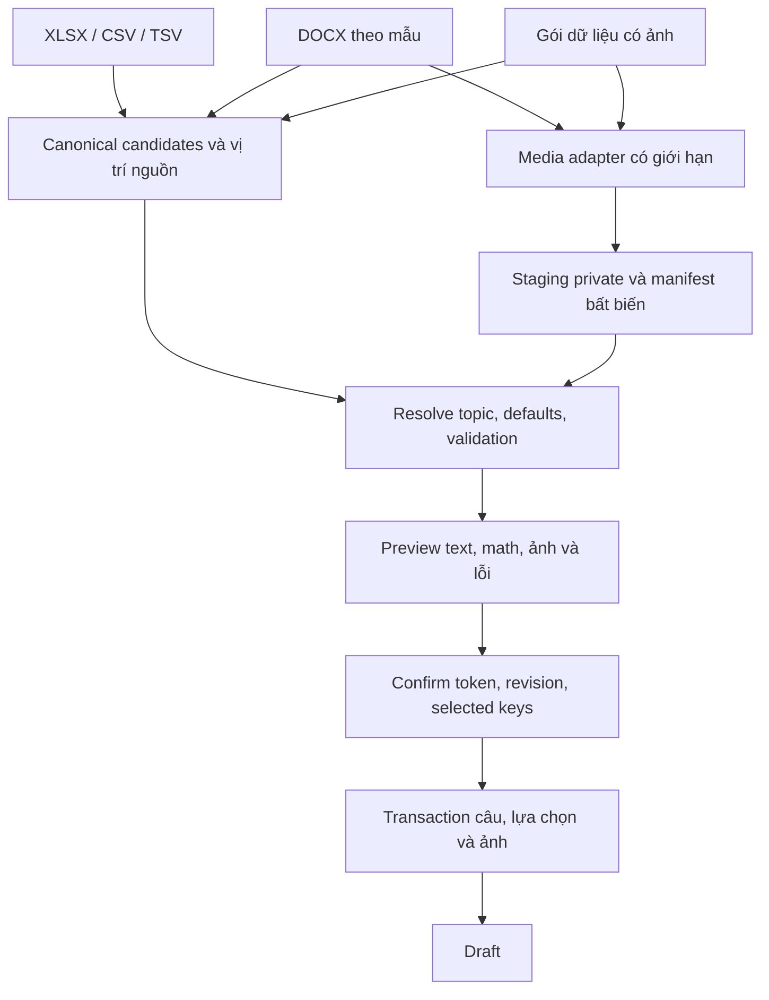

# Plan mở rộng import câu hỏi: DOCX, TSV và hình ảnh

> Ngày: **15/10/2026**. Trạng thái: **HOÀN THÀNH TRIỂN KHAI VÀ KIỂM CHỨNG TOÀN DIỆN (E0, E1, E3, E4)**.
> Người dùng đã yêu cầu triển khai **E0/E1/E3/E4**; **không triển khai TSV (E2)** và **E5 cần spec riêng**. Các đoạn TSV bên dưới giữ làm tham khảo thiết kế, không phải khả năng sản phẩm.
> Kế thừa [plan import V1](QUESTION-BANK-IMPORT-PLAN-2026-10-12.md) và [bản Việt hóa/bảng LaTeX](../verification/QUESTION-IMPORT-LOCALIZATION-REPORT-2026-10-15.md). Các giới hạn mới bên dưới là giá trị đề xuất cần kiểm chứng.

### Quyết định E0 đã chốt

- API V2 riêng `/api/v1/questions/import-v2/{preview,confirm}`; `templateVersion=2.0`; `sourceProfile=docx-1.0` hoặc `media-1.0`. V1 giữ schema 1.0 và giới hạn upload 10 MiB.
- DOCX đọc ZIP/XML bằng API .NET hiện có với kiểm tra CRC, budget và whitelist cấu trúc; chưa thêm SDK OpenXML tổng quát. Không dùng Office automation. Mẫu hai cột và vị trí source là contract rõ, không đoán đề Word tự do.
- Decode ảnh server dùng **SkiaSharp 4.153.1** và **SkiaSharp.NativeAssets.Linux.NoDependencies 4.153.1**, license MIT; đã smoke test bộ giải mã trong Linux runtime API. Không dùng System.Drawing phụ thuộc Windows. Xác nhận từ [NuGet SkiaSharp](https://www.nuget.org/packages/SkiaSharp/4.153.1), [native Linux](https://www.nuget.org/packages/SkiaSharp.NativeAssets.Linux.NoDependencies/4.153.1).
- E4 chuyển có kiểm soát: phân số, căn, chỉ số/lũy thừa, tích phân/tổng, giới hạn/hàm, dấu ngoặc, ma trận/hệ, một số dấu nhấn. Công thức cùng dòng `$...$`, khối `$$...$$`; editor giữ kiểu hiển thị qua sửa/lưu. Cấu trúc ngoài subset báo lỗi, không ghép text con thay công thức.
- Không thêm migration: ảnh cuối dùng `QuestionImage` hiện có. Staging vẫn local/process-local, chưa có multi-instance hoặc durable receipt.

## 1. Khuyến nghị để duyệt

| Câu hỏi | Đề xuất | Lý do và giới hạn |
| --- | --- | --- |
| Có nên nhận DOCX? | **Có, bắt đầu bằng DOCX theo mẫu có cấu trúc.** | Có ích cho giáo viên quen Word và câu có hình; chưa hứa đọc đúng mọi bộ đề Word có sẵn. Công thức Equation cần xử lý riêng. |
| TSV có tác dụng gì? | **Kênh phụ trao đổi dữ liệu bảng; ưu tiên thấp.** | Thuận tiện với dữ liệu phân cách bằng tab từ bảng tính, script hoặc hệ thống khác. Không giải quyết công thức Word hay hình ảnh. |
| Có nên xử lý ảnh khi import? | **Có; ưu tiên một ảnh đề bài/câu và preview trước khi lưu.** | Dùng được cho hình học, đồ thị, sơ đồ và đề ở dạng ảnh; tận dụng mô hình ảnh câu hỏi đã có. |
| Nhận ảnh thả nổi trong Excel ngay? | **Chưa.** | Vị trí ảnh trên ô không đủ làm định danh câu. Đợt đầu dùng file ảnh có mã tham chiếu rõ; DOCX dùng ô ảnh trong đúng khối câu hỏi. |
| OCR/AI tự đọc ảnh, tự suy ra đáp án? | **Tách thành kế hoạch khác.** | Nhập và lưu ảnh là một chức năng khác với trích xuất chính xác nội dung/chấm đáp án từ ảnh. |

**Thứ tự đề xuất:** chốt contract và thử nghiệm kỹ thuật → nền tảng ảnh + gói Excel/CSV có ảnh → DOCX theo mẫu → Office Math/OMML theo tập con đã kiểm chứng. TSV có thể làm song song như một adapter nhỏ nếu có nguồn sử dụng; không là điều kiện để bàn giao ảnh/DOCX.

XLSX vẫn là kênh nhập bảng chính. Editor hiện có tiếp tục phục vụ câu phức tạp, ảnh cần chỉnh và rubric nâng cao. Mọi kênh nhập đều qua cùng kiểm tra và chỉ tạo **Draft**.

## 2. Hiện trạng source đã đối chiếu

| Khu vực | Đã có | Khoảng cách cần xử lý |
| --- | --- | --- |
| Parser import | XLSX/CSV; TXT chỉ trong legacy. Scanner delimited text có thử dấu tab. | `.tsv` và `.docx` chưa được nhận; không coi việc đọc được tab bên trong CSV là hỗ trợ TSV chính thức. |
| Template/preview | Header Việt/Anh, topic từng câu, defaults, kiểm tra LaTeX, token/revision và chọn tập câu hợp lệ. | Chưa có source location riêng cho Word và chưa có asset ảnh tạm. |
| XLSX | Chủ động chặn media/drawing/chart/embedding và liên kết ngoài. | Không được gỡ toàn bộ guard này để tuyên bố hỗ trợ ảnh. |
| Ảnh nhập thủ công | Browser nhận PNG/JPG/WebP, nguồn tối đa 8 MiB/24 triệu pixel; chuyển PNG, cạnh dài tối đa 2048 px, kết quả tối đa 2 MiB. | Bulk import/DOCX không đi qua browser canvas này; cần bước chuẩn hóa ảnh ở server. |
| Kiểm tra ảnh ở server | `QuestionImageContent` kiểm tra PNG đã chuẩn hóa: chunks/CRC/kích thước, giải nén IDAT và chiều dài scanline. | Chưa là bộ giải mã/chuyển JPG/WebP, tái tạo pixel và encode lại ảnh. Không gọi đây là pipeline chuẩn hóa server hoàn chỉnh. |
| Lưu ảnh | `QuestionImage`: một ảnh cho `(CenterId, QuestionId)`, BLOB và SHA-256; form create ghi cùng transaction. | Import chưa ghi ảnh; ảnh riêng trong đáp án/lời giải hoặc nhiều ảnh/câu cần mô hình khác. |
| Quyền xem ảnh | Có endpoint ảnh câu hỏi theo tenant/quyền giáo viên/học sinh. | Câu chưa lưu chưa có QuestionId; ảnh preview cần endpoint và kiểm tra quyền riêng. |
| Phiên import | Process-local, 30 phút; JSON cache tổng 30 MiB, 2 preview đồng thời. | Không thể nhét hàng chục ảnh Base64 vào cache hiện tại; cần quota/staging riêng. |

Nguồn code để người triển khai mở kiểm tra:

- [Parser](../../src/EduTwin.BLL/CurriculumAndQuestions/Import/QuestionImportFileParser.cs), [use case import](../../src/EduTwin.BLL/CurriculumAndQuestions/Import/QuestionImportUseCase.cs), [DTO](../../src/EduTwin.Contracts/CurriculumAndQuestions/QuestionImportDtos.cs).
- [Chuẩn hóa ảnh ở browser](../../web/edutwin-web/src/utils/questionImage.ts), [kiểm tra PNG](../../src/EduTwin.BLL/CurriculumAndQuestions/QuestionImageContent.cs).
- [Create và transaction ảnh](../../src/EduTwin.BLL/CurriculumAndQuestions/CreateQuestionUseCase.cs), [quyền đọc ảnh](../../src/EduTwin.BLL/CurriculumAndQuestions/GetQuestionImageUseCase.cs), [model ảnh](../../src/EduTwin.DAL/CurriculumAndQuestions/QuestionImage.cs).

## 3. Trải nghiệm sử dụng chung

1. Chọn môn và defaults như hiện tại; owner vẫn là giáo viên đang đăng nhập.
2. Chọn kiểu nguồn: **Excel/CSV**, **DOCX theo mẫu**; TSV nằm trong nhóm định dạng văn bản bổ sung nếu được bật.
3. Tải mẫu phù hợp. Tên trường hiển thị tiếng Việt; mã chủ đề lấy theo môn.
4. Upload file hoặc gói có ảnh. UI công bố đúng định dạng, loại công thức và giới hạn của từng profile.
5. Hệ thống phân tích câu, ánh xạ ảnh, chuẩn hóa và kiểm tra; chưa ghi vào ngân hàng.
6. Preview hiển thị đầy đủ text, công thức, ảnh đã xử lý, đáp án, lời giải, topic/defaults và các lỗi theo vị trí nguồn. Có thể phóng ảnh để đọc chữ/ký hiệu.
7. Sửa nguồn rồi tải lại. Đợt đầu chưa thêm editor tại preview; thay nguồn/defaults làm mất hiệu lực preview cũ.
8. Xác nhận tập câu hợp lệ rõ ràng → lưu Draft trong transaction → mở editor để rà soát/kích hoạt.

Nếu một câu có ảnh bị lỗi hoặc công thức chưa được hỗ trợ, câu đó chưa đủ điều kiện nhập. Không âm thầm bỏ ảnh hoặc bỏ công thức rồi vẫn cho câu hợp lệ. Lỗi package làm mất khả năng xác định cấu trúc phải chặn toàn file; chỉ lỗi độc lập theo câu mới được chọn nhập một phần.

## 4. DOCX: nhận theo mẫu trước, không đoán mọi đề Word

### 4.1. Phạm vi đầu tiên

Word lưu nội dung qua các paragraph/run; đọc text thuần không giữ mọi cấu trúc của tài liệu. Vì vậy cần adapter hiểu cấu trúc thay cho cách cắt chuỗi bằng `Câu 1`, `A.`, chữ đậm hoặc gạch chân. [Microsoft: cấu trúc WordprocessingML](https://learn.microsoft.com/en-us/office/open-xml/word/structure-of-a-wordprocessingml-document).

Template đề xuất: **mỗi câu một bảng phẳng hai cột “Trường / Nội dung”**, giúp giáo viên nhập nội dung dài và hình thuận tiện hơn bảng Word rộng 26 cột.

| Trường trong mẫu Word | Ví dụ/cách nhập |
| --- | --- |
| Mã câu hỏi | Q001; bắt buộc và không trùng trong file |
| Mã chủ đề | MATH-GEOM; kiểm tra theo môn đã chọn |
| Loại câu hỏi | Mã loại theo template hiện có, có giải thích tiếng Việt |
| Khối / Độ khó / Điểm / Thời gian | Điền theo câu hoặc dùng defaults hợp lệ của lô |
| Nội dung câu hỏi | Văn bản và LaTeX inline `$...$` trong giai đoạn đầu |
| Ảnh đề bài | Tối đa một ảnh inline trong chính ô này, khi media pipeline đã sẵn sàng |
| Lựa chọn A–D | Câu trắc nghiệm phải khai báo như form; dạng khác để trống |
| Đáp án đúng | A/B/C/D, đáp án ngắn hoặc đáp án mẫu, theo loại/mode |
| Lời giải | Bắt buộc theo quy tắc hiện hành |
| Lập luận / Ý bắt buộc / Lỗi thường gặp / Ghi chú | Các trường tùy chọn hiện có, có cấu trúc rõ |
| Chế độ chấm / Yêu cầu giải trình / Phạm vi / Ngôn ngữ | Giữ semantics như XLSX/CSV |

Tài liệu có bảng metadata riêng: **phiên bản profile DOCX**, **môn nguồn** và hướng dẫn/danh mục topic do hệ thống tạo. Adapter phân biệt bảng câu hỏi, bảng hướng dẫn và bảng metadata bằng marker rõ; không coi mọi bảng trong Word là câu hỏi. Mã câu/metadata không cấp quyền owner hay tenant.

Đợt đầu, “Ý bắt buộc” và “Lỗi thường gặp” dùng JSON array trong ô như V1, ví dụ `["Ý một","Ý hai"]`. Không tự suy item từ bullet/numbering hoặc dấu `;`/`|`. Profile mỗi đoạn là một item, nếu cần, phải được định nghĩa/version riêng sau.

### 4.2. Công thức Word cần xử lý riêng

Word/Office có thể lưu công thức bằng **OMML**, kể cả khi người soạn đã dùng chế độ nhập LaTeX. Do đó, lấy text trong DOCX không bảo đảm thu được chuỗi `\frac{...}{...}`. [Microsoft: Office Math và các định dạng hỗ trợ](https://learn.microsoft.com/en-us/office/math/).

| Nguồn công thức | Giai đoạn đầu | Nâng cấp sau |
| --- | --- | --- |
| LaTeX dạng chữ `$...$` trong nội dung | Nhận và dùng validator/renderer hiện có | Giữ corpus và giới hạn V1 |
| Word Equation/OMML inline | Phát hiện và báo chưa hỗ trợ, có vị trí | Spike chuyển OMML → canonical math cho tập con được công bố |
| OMML dạng block/display | Không tự đổi thành inline | Chỉ nhận khi representation và editor giữ được kiểu hiển thị |
| MathType/OLE/Equation cũ | Báo không hỗ trợ | Nghiên cứu adapter riêng nếu có nhu cầu thực tế |
| Công thức đã là ảnh | Nhận như một phần của ảnh đề theo profile ảnh | Không tự OCR thành đáp án/công thức có thể sửa |

Spike OMML phải có corpus phân số, căn, lũy thừa/chỉ số, giới hạn, tích phân và hệ/matrix; đánh dấu rõ trường hợp không chuyển được. Không lấy các text con ghép lại rồi xem là công thức đúng. Chuyển đổi/render thành công cũng không mở rộng khả năng chấm `MathEquivalent` thành CAS tổng quát.

Nếu bộ đề Word thực tế chủ yếu dùng Equation, bản DOCX chỉ nhận LaTeX dạng chữ nên là **pilot có nhãn phạm vi rõ**; chưa quảng bá là nhập các bộ đề Word thông thường. Kết quả spike quyết định thời điểm mở DOCX rộng rãi.

### 4.3. Quy tắc đọc và báo lỗi

- Ghép run/text đúng thứ tự; không tự thêm khoảng trắng giữa các run vì một lệnh LaTeX có thể bị Word chia ra nhiều run. Ngắt đoạn/dòng được hỗ trợ chuyển thành LF.
- Các nhãn trường dùng mapping Việt/Anh hiện có; thiếu hoặc trùng trường bắt buộc phải báo lỗi.
- Đợt đầu từ chối nested/merged tables, floating textboxes, SmartArt/charts, OLE, external relationships, fields/altChunk và tracked changes chưa xử lý.
- Phát hiện nội dung câu hỏi/ảnh trong header/footer/footnote hoặc ngoài cấu trúc mẫu; không âm thầm bỏ những phần có thể chứa dữ kiện. Bảng hướng dẫn và trang trí được phép phải có quy tắc nhận diện riêng.
- Vị trí lỗi hiển thị “Q001 · bảng 3 · trường Lời giải · đoạn 2”. Không hứa số trang Word khi chưa có renderer/pagination đáng tin cậy.
- Không dùng Office/Word automation để mở hoặc chạy tài liệu trên server. Ưu tiên spike SDK OpenXML và decoder phù hợp; chốt package, license và footprint trước khi thêm dependency.

## 5. TSV: dùng khi nào và có gì khác CSV?

**TSV là dữ liệu bảng dạng text phân cách các trường bằng ký tự tab.** Dữ liệu CSV thường phân cách bằng dấu phẩy. Đây là hai cách tuần tự hóa bảng; Microsoft cũng hỗ trợ text phân cách bằng tab trong quy trình import/export Excel. [Microsoft: import/export text và CSV](https://support.microsoft.com/en-us/office/import-or-export-text-txt-or-csv-files-5250ac4c-663c-47ce-937b-339e391393ba).

Ví dụ minh họa dưới đây dùng `<TAB>` để chỉ ký tự tab thực, không phải chuỗi sẽ ghi vào file:

```text
Mã câu hỏi<TAB>Mã chủ đề<TAB>Loại câu hỏi<TAB>Khối<TAB>Nội dung câu hỏi<TAB>Đáp án đúng<TAB>Lời giải<TAB>Chế độ chấm
Q001<TAB>MATH-FRAC<TAB>ShortAnswer<TAB>12<TAB>Tính $\frac{1}{2}+\frac{1}{3}$.<TAB>5/6<TAB>Quy đồng được $\frac{5}{6}$.<TAB>NumericRational
```

Môn đích vẫn chọn trên UI; `MATH-FRAC` phải là mã thực thuộc môn đó. Các trường tùy chọn chưa có trong ví dụ dùng defaults của lô.

**Lợi ích:** thuận tiện với bảng xuất từ script/công cụ khác và dữ liệu văn bản có nhiều dấu phẩy, chẳng hạn tọa độ hoặc lời giải. Tuy nhiên CSV có quoting đúng cũng xử lý được các trường hợp đó; TSV không phải cách sửa lỗi parser CSV.

**Không bổ sung:** sheet, dropdown, style, ảnh nhúng, khả năng nhận Equation Word hoặc khả năng chấm toán. Nó cũng không tự ngăn Excel đổi `1/2` thành ngày khi người dùng mở/import sai kiểu dữ liệu.

Contract đề xuất khi bật TSV:

1. Nhận `.tsv` tường minh, UTF-8, BOM tùy chọn; delimiter cố định là tab, không fallback sang dấu phẩy/chấm phẩy.
2. Profile EduTwin dùng quoting tương tự scanner CSV hiện có: trường chứa tab/newline/nháy được bọc bằng `"`; nháy trong trường thành `""`. Công bố profile này, không hứa nhận mọi biến thể TSV/escape khác.
3. Giữ nguyên LaTeX/backslash; không giải mã `\t` hoặc `\n` dạng chữ như escape lập trình. Giữ vị trí dòng vật lý bắt đầu của record.
4. Giữ 26 trường và alias Việt/Anh, defaults, JSON arrays, validation và Draft. File text chỉ có `ImageRef` không đủ để nhập ảnh; cần package có asset thực.
5. Tái sử dụng scanner theo `delimiter/sourceFormat`; đổi nhãn nguồn lỗi thành TSV, kiểm tra số cột và quoting đầy đủ.
6. Thêm tải mẫu TSV, MIME `text/tab-separated-values;charset=utf-8`, cập nhật accept/API/spec/tests. Không mở rộng `.txt` thành mọi định dạng tự đoán; UTF-16 phải được báo rõ/chuyển sang UTF-8 theo hướng dẫn.

**Ưu tiên:** có thể làm gọn sau khi chốt contract, nhưng chưa cần bật nếu giáo viên chỉ dùng Excel/Word và chưa có nguồn TSV.

## 6. Import câu có ảnh: phạm vi và cách nhập

### 6.1. Đợt đầu hỗ trợ một ảnh đề/câu

- Ảnh là dữ kiện/đồ thị/sơ đồ hoặc toàn bộ đề bài. Giáo viên vẫn cung cấp topic, khối, loại câu, đáp án, lời giải và tiêu chí như hiện tại.
- Câu chỉ có ảnh được dùng placeholder text hiện có **sau khi ảnh đã hợp lệ**. Không cho placeholder thay cho một file ảnh thiếu/hỏng.
- Nếu ảnh chứa cả A–D, vẫn phải điền các lựa chọn/đáp án có cấu trúc cho câu trắc nghiệm; chưa tự trích xuất từ ảnh.
- Mô tả hoặc chú thích có ý nghĩa được nhập trong “Nội dung câu hỏi”; không giấu dữ kiện vào ghi chú chấm.
- Chưa có ảnh độc lập cho từng option/lời giải, nhiều ảnh/câu hoặc tự ghép nhiều ảnh. Các nhu cầu đó cần model/rendering và migration riêng nếu được duyệt sau.

### 6.2. Cách đóng gói đề xuất

| Cách nhập | Quyết định |
| --- | --- |
| XLSX/CSV + ảnh trong gói ZIP theo mẫu | **Kênh đầu tiên cho bulk có ảnh**; mapping theo mã, có kiểm tra thiếu/trùng/orphan |
| DOCX với ảnh inline trong ô “Ảnh đề bài” | Nhận sau khi DOCX adapter và media pipeline đạt gate |
| Chèn ảnh thả nổi/neo vào ô Excel | Hoãn; không đoán ảnh thuộc câu nào bằng tọa độ |
| URL ảnh ngoài, đường dẫn máy người dùng, Base64 trong ô | Không nhận ở profile đầu tiên |
| Nhiều ảnh/ảnh từng đáp án | Hoãn; có thể dùng editor trong giới hạn hiện hành hoặc task nâng cấp riêng |

Gói ví dụ:

```text
question-package.zip
├── questions.xlsx          # hoặc questions.csv; đúng một file dữ liệu
└── media/
    ├── Q001.png
    └── Q003.jpg
```

Template mới thêm cột **“Mã ảnh đề bài”** (`ImageRef`), ví dụ `media/Q001.png`. Khi có media, `QuestionKey` bắt buộc và không trùng. Tên file không tự quyết định câu; giá trị ImageRef phải match đúng asset. Từ chối ref thiếu, đường dẫn không hợp lệ, hai entry cùng đường dẫn sau chuẩn hóa và media không được tham chiếu. Nhiều câu được phép tham chiếu cùng một asset đã khai báo, nhưng quota/output BLOB tính theo mỗi lần gán; cleanup dùng ownership/ref-count của phiên. Không dùng số dòng làm khóa ảnh.

Ảnh trong Word cần resolve relationship tới đúng media part; tài liệu Microsoft minh họa ảnh được nhúng qua `ImagePart` và relationship trong nội dung. [Microsoft: ảnh trong WordprocessingML](https://learn.microsoft.com/en-us/office/open-xml/word/how-to-insert-a-picture-into-a-word-processing-document).

DOCX đợt đầu chỉ nhận một ảnh **inline trong đúng ô ảnh của khối câu hỏi**. Không gán ảnh gần đoạn văn hoặc từ anchor nổi. Ảnh có crop/rotation/flip/group phải được tái tạo đúng hoặc báo lỗi chưa hỗ trợ; lấy nguyên ảnh nguồn chưa crop có thể khác nội dung giáo viên đang thấy. Đợt đầu chọn **báo lỗi và hướng dẫn xuất lại ảnh đã xử lý**.

### 6.3. Pipeline media cần bổ sung

1. Kiểm tra package, reserve quota rồi đọc theo stream vào vùng tạm private ngoài webroot; không giải nén theo đường dẫn do file điều khiển.
2. Nhận diện nội dung thực, kiểm tra pixel/dung lượng trước khi cấp phát lớn. Không tin extension/MIME hoặc browser đã xử lý hộ.
3. Decode và normalize ở server: PNG/JPEG/WebP tĩnh → orientation đúng, bỏ metadata không cần thiết, resize có giới hạn, nền thống nhất và encode PNG theo profile hệ thống. Không cắt mất dữ kiện. Server kiểm tra format/pixel/bytes và báo ảnh vượt giới hạn; giáo viên xác nhận độ rõ của chữ/ký hiệu ở preview, không hứa tự nhận biết mọi ảnh mờ.
4. Dùng verifier PNG hiện có sau normalize; refactor để nhận binary/stream, giữ adapter dataURL cho form thủ công. Không đổi PNG sang Base64 chỉ để gọi lại hàm cũ.
5. Lưu file tạm bất biến và manifest `{questionKey, assetId, sha256, byteLength, width, height, sourceLocation}`. Cache JSON chỉ giữ refs/metadata, không chứa image bytes/Base64.
6. Preview tải binary có quyền qua API, tạo Blob URL và revoke khi đóng/đổi phiên. Không dùng đường dẫn file tạm hoặc URL công khai.
7. Confirm kiểm tra refs/hash và quyền/trạng thái lại; ghi `Questions + Options + QuestionImages + HasImage` trong cùng transaction. Tận dụng BLOB hiện có cho một ảnh/câu; không mặc định cần đổi schema câu hỏi.

Thư viện giải mã, xử lý orientation/metadata, giới hạn decode và việc kiểm tra loại ảnh động phải được spike. SVG/GIF/EMF/WMF và vector/SmartArt nằm ngoài profile đầu tiên. Không fetch linked image từ Internet.

## 7. Contract và phiên import chung



Đề xuất bổ sung, **chưa sửa contract authoritative trong bước lập plan**:

- Giữ request ngữ cảnh môn/defaults và confirm token/revision/selected keys. Không nhận nội dung thay thế hoặc đường dẫn media do client gửi lại ở confirm.
- Đề xuất route preview/confirm V2 riêng cho DOCX/media, chẳng hạn `/questions/import-v2/preview` và `/questions/import-v2/confirm`, cùng route asset tạm theo session. Giữ endpoint V1 và trần request 11 MiB hiện có. Route V2 có trần multipart riêng, đề xuất 32 MiB cho file tối đa 30 MiB và overhead; chốt tên route tại E0.
- Thêm `sourceFormat`, `sourceLocation` và định danh candidate ổn định. DOCX có `partPath` (ví dụ `word/document.xml`, `word/footnotes.xml`) cùng table/row/cell/paragraph/field/relationship, không giả lập tất cả thành “dòng CSV”. Đếm câu lỗi theo candidate ID, tránh gộp hai bảng Word cùng row index.
- Preview trả `imageAssetId`, kích thước/hash/cảnh báo và `hasImage`; không trả Base64. Mọi thay đổi mapping/asset phải cấp revision mới hoặc bắt tạo preview mới.
- Có endpoint ảnh tạm theo session/asset ID opaque, kiểm tra actor + tenant + session + revision + TTL. Dùng authenticated binary request như ảnh câu hỏi hiện có; không dựa vào token trong URL làm quyền duy nhất.
- Profile media/template mới cần version riêng, đề xuất `templateVersion=2.0` cho tập trường có ảnh; `sourceProfile` riêng xác định cách đọc `docx-1.0` hoặc `media-1.0`. Không dùng chuỗi profile thay cho templateVersion và không đưa version mới vào endpoint V1 chỉ nhận 1.0. Giữ nhánh V1/legacy nguyên hành vi, không bắt file cũ có cột ảnh. TSV text-only có thể dùng tập trường V1.
- Lưu cả `templateVersion` và `sourceProfile` vào metadata/snapshot/hash của phiên; từ chối tổ hợp schema/profile chưa hỗ trợ. Tên/version cuối cùng chốt ở E0, không để adapter tự đoán.
- Giữ role Teacher, kiểm tra topic cùng môn/tenant và giới hạn mode chấm. Không thêm quyền authoring cho CenterManager qua định dạng mới.

Lifecycle bắt buộc của staging:

| Sự kiện | Hành vi |
| --- | --- |
| File/package hỏng, lỗi toàn phiên hoặc hủy trước khi có preview | Xóa toàn bộ tài nguyên tạm của phiên, nhả quota |
| Lỗi độc lập ở một câu/ảnh | Đánh dấu câu không hợp lệ, dọn phần chỉ thuộc câu đó; giữ câu/asset hợp lệ để preview và nhập một phần. Asset dùng chung chỉ dọn khi không còn ref hợp lệ |
| Preview hợp lệ, đang chờ xác nhận | Giữ asset bất biến tới TTL; xem ảnh cần quyền |
| Confirm đang xử lý | Pin/lease phiên, cleaner không xóa ảnh đang dùng |
| DB rollback có thể retry | Giữ phiên/assets còn hạn; không tạo câu hoặc ảnh vĩnh viễn một phần |
| Commit thành công, kể cả nhập một phần | Consume token; dọn cả ảnh đã chọn lẫn bị bỏ qua; dọn lỗi được sweeper retry |
| Hết hạn/bỏ dở/restart | Cleanup định kỳ và startup orphan sweep, nhả quota |
| Kết quả commit không xác định | Không tự retry. Giữ hành vi kiểm tra ngân hàng trước khi nhập lại; chỉ hứa idempotency bền vững khi có durable receipt được thiết kế riêng |

Đề xuất đợt đầu một instance + staging local có quota, tương ứng session process-local hiện tại. Multi-instance cần shared session/media hoặc routing được thiết kế rõ; không xem disk local là store dùng chung.

## 8. Giới hạn dự kiến và rủi ro cần đo

**Các mức mới là đề xuất để spike, không phải khả năng đã được nghiệm thu.** Không tăng giới hạn endpoint V1 đồng loạt chỉ vì thêm ảnh.

| Hạng mục | Đề xuất ban đầu |
| --- | --- |
| XLSX/CSV/TSV text-only | Giữ 10 MiB, 500 câu và các giới hạn XML/field hiện có |
| DOCX/gói media upload | Tối đa 30 MiB; cấu hình request/reverse proxy riêng và tính overhead multipart |
| Nội dung mở rộng archive | Tối đa 100 MiB thực đọc, 500 entries; budget dùng chung qua outer ZIP và XLSX con được phép |
| Số ảnh | Tối đa 20 câu có ảnh/lô, một ảnh/câu; câu không ảnh vẫn chịu trần tổng 500 câu |
| Ảnh nguồn | Tối đa 8 MiB/ảnh, 24 triệu pixel; tổng nguồn ảnh sau giải nén tối đa 40 MiB |
| Ảnh chuẩn hóa | PNG tối đa 2 MiB, cạnh dài tối đa 2048 px; tổng theo số lần gán ảnh tối đa 40 MiB/lô |
| Staging disk | 100 MiB/actor, 500 MiB/center, 1 GiB/process; áp dụng đồng thời, reserve trước ghi và có high-water cleanup |
| Decode ảnh | Khởi đầu 1 worker/process, timeout/cancellation; điều chỉnh sau benchmark |
| Session và RAM | Giữ TTL 30 phút, tối đa 2 preview xử lý, quota JSON 30 MiB riêng; không tính media như JSON cache |

Quotas phải tính cả tài nguyên tạm tồn tại trong lúc normalize và số lần một ảnh được gán cho nhiều câu; không chỉ cộng file nén hoặc deduplicate hash rồi bỏ qua dung lượng BLOB sẽ ghi. Chỉ cho mức nesting outer package → XLSX theo profile, không đọc ZIP đệ quy tùy ý.

Giữ chống path traversal, symlink, tên trùng, ZIP bomb, XML/XXE và active content. DOCX không được kéo HTML/OLE/liên kết ngoài vào nội dung hiển thị. Ghi lỗi có vị trí, không ghi toàn văn đề hoặc bytes ảnh vào log vận hành.

Ghi ảnh theo batch byte có giới hạn trong cùng transaction; integration test phải kiểm tra BLOB và cấu hình packet của MySQL. Benchmark riêng thời gian parse/normalize/preview/commit, peak RAM, disk high-water và cancellation với lô ảnh nặng nhất. SLO chỉ chốt sau đo.

## 9. Giai đoạn thực hiện sau khi duyệt

| Giai đoạn | Đầu ra | Gate hoàn thành |
| --- | --- | --- |
| E0 — Chốt profile và spike | Corpus DOCX/ảnh thực tế, capability matrix, contract/version, decoder/OpenXML dependency, quotas và chi phí vận hành | Có ví dụ đọc đúng/lỗi rõ; quyết định phạm vi OMML và library/license; không phát hành nút nhận mọi DOCX |
| E1 — Nền tảng media + gói XLSX/CSV | Staging/ACL/normalizer, ImageRef, preview và transaction ảnh; template gói có hướng dẫn | Mapping đúng; không bỏ dữ kiện; MySQL rollback, cleanup, editor/student/AI dùng được ảnh |
| E2 — TSV tùy nhu cầu | Adapter tab cố định, template, UI/API/spec và corpus | Semantics tương đương CSV, Unicode/LaTeX/multiline đúng; không nhận nhầm delimiter |
| E3 — DOCX theo mẫu | Generator mẫu Word hai cột, adapter text/LaTeX/ảnh inline và vị trí lỗi | Cùng pipeline E1; file ngoài profile báo rõ, giữ topic/defaults/ảnh/đáp án |
| E4 — OMML có kiểm soát | Converter tập con được công bố, corpus đối chiếu và source/display policy | Không sai nghĩa hoặc mất format ngoài mức đã công bố; lỗi math chưa hỗ trợ có vị trí; quyết định mở DOCX rộng rãi |
| E5 — Chỉ khi có yêu cầu riêng | Word tự do, OCR/AI, ảnh option/nhiều ảnh, media exchange nâng cao | Spec/model/quyền/chi phí và acceptance corpus riêng |

E1 và E2 có thể làm song song sau E0; E3 ảnh phụ thuộc E1. E4 spike từ E0 nhưng chưa là lời hứa chuyển mọi Equation. Chưa đặt deadline chắc chắn khi chưa có corpus và số đo decoder; mức nỗ lực tương đối: TSV nhỏ, media lớn, DOCX theo mẫu vừa–lớn, OMML lớn và phụ thuộc độ phủ.

## 10. Checklist nghiệm thu

- [x] Mẫu tiếng Việt cũ vẫn import đúng; V1 không đổi guard hoặc buộc có ảnh.
- [-] TSV: Đã thống nhất hoãn/không triển khai theo quyết định phạm vi E0 (giữ nguyên spec tham khảo, không thuộc gate nghiệm thu sản phẩm).
- [x] DOCX: run bị chia giữa lệnh LaTeX, bảng metadata/topic xen kẽ, nhiều question block; không nhầm dấu A./B. trong đề/lời giải thành ranh giới câu.
- [x] Word ngoài profile, OMML chưa nhận, crop/rotate, ảnh nổi hoặc ảnh trong option được báo rõ; không bị drop rồi đánh dấu câu hợp lệ.
- [x] Ảnh thiếu/trùng/orphan/sai loại/hỏng/quá pixel/ảnh động/ZIP lồng sai profile bị chặn; preview là ảnh chuẩn hóa thực sẽ lưu.
- [x] Câu chỉ có ảnh chỉ hợp lệ khi có asset hợp lệ; đáp án, lời giải, lựa chọn, topic và grade vẫn kiểm tra đầy đủ.
- [x] Cross-tenant/actor hoặc student không đọc được ảnh preview; URL/file path không bỏ qua ACL; token hết hạn không confirm được.
- [x] Confirm revalidate môn/topic/owner/assets; transaction lỗi sau khi ghi ảnh rollback cả tập trên MySQL thật; retry không tạo trùng.
- [x] Partial import báo chính xác valid/invalid/skipped và dọn media không được chọn; cleaner không đua xóa ảnh đang confirm.
- [x] Hết hạn, hủy, restart, commit uncertainty và lỗi cleanup có hành vi đã kiểm chứng, không hứa durable idempotency khi chưa có receipt.
- [x] E2E: import ảnh → Draft → reload editor/thay ảnh/xóa ảnh → kích hoạt/giao bài bằng quyền hiện có → học sinh xem đúng → pipeline AI nhận đúng ảnh câu hỏi khi cấu hình cho phép.
- [x] Corpus OMML đối chiếu source/preview/editor/student, giữ inline/display theo profile; mode chấm vẫn có giới hạn cũ.
- [x] Benchmark lô text 500 câu và lô media cực đại đạt SLO/quota đã chốt, không ảnh hưởng đáng kể luồng import V1.
- [x] API_CONTRACTS, UI_UX_SPEC, template, thông báo unsupported và verification report thống nhất trước rollout. Migration chỉ thêm khi thiết kế thực sự cần, không mặc định để đọc DOCX/TSV.

## 11. Các mục đề nghị duyệt

- [x] **Duyệt hướng ưu tiên:** media một ảnh/câu + gói XLSX/CSV, sau đó DOCX theo mẫu (Đã duyệt & hoàn thành E0/E1/E3/E4).
- [x] **Duyệt phạm vi DOCX đầu tiên:** bảng hai cột, text/LaTeX dạng chữ và ảnh inline; native Equation qua spike/giai đoạn riêng, không đoán Word tự do (Đã duyệt & hoàn thành).
- [x] **Duyệt TSV là tùy chọn:** hoãn/không triển khai; không bắt buộc thay XLSX hoặc nằm trong gate ảnh/DOCX (Đã chốt không triển khai E2).
- [x] **Duyệt giới hạn một ảnh đề/câu:** chưa có ảnh độc lập trong option/lời giải; không OCR/tự suy đáp án (Đã chốt & tuân thủ).
- [x] **Duyệt hướng staging/transaction:** server normalization, refs thay Base64, ACL ảnh tạm, quota/TTL/cleanup; final PNG dùng storage hiện có (Đã duyệt & hoàn thành).
- [x] **Duyệt cách chốt kỹ thuật:** E0 xác nhận corpus, package/license và quotas/SLO trước khi mở rộng release; thay đổi lớn được ghi lại trong plan/contract (Đã duyệt & hoàn thành).

Toàn bộ các giai đoạn E0, E1, E3, E4 đã được hoàn tất triển khai và kiểm chứng toàn diện (tham chiếu báo cáo [QUESTION-IMPORT-V2-REPORT-2026-10-15.md](../verification/QUESTION-IMPORT-V2-REPORT-2026-10-15.md)).
